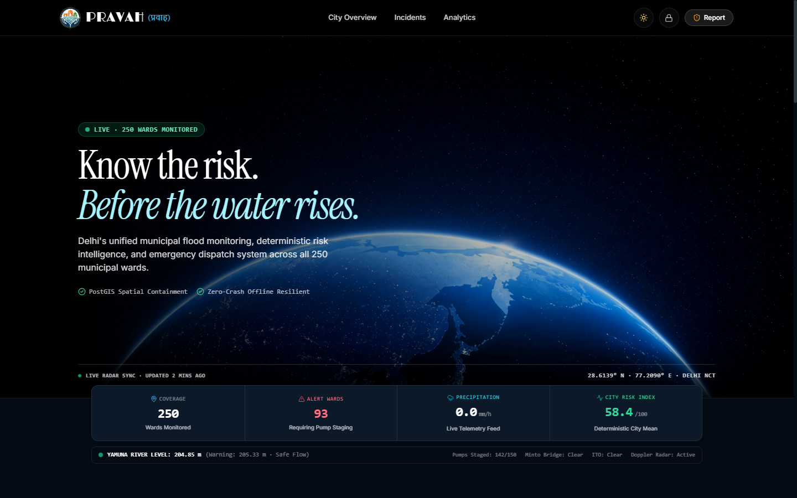
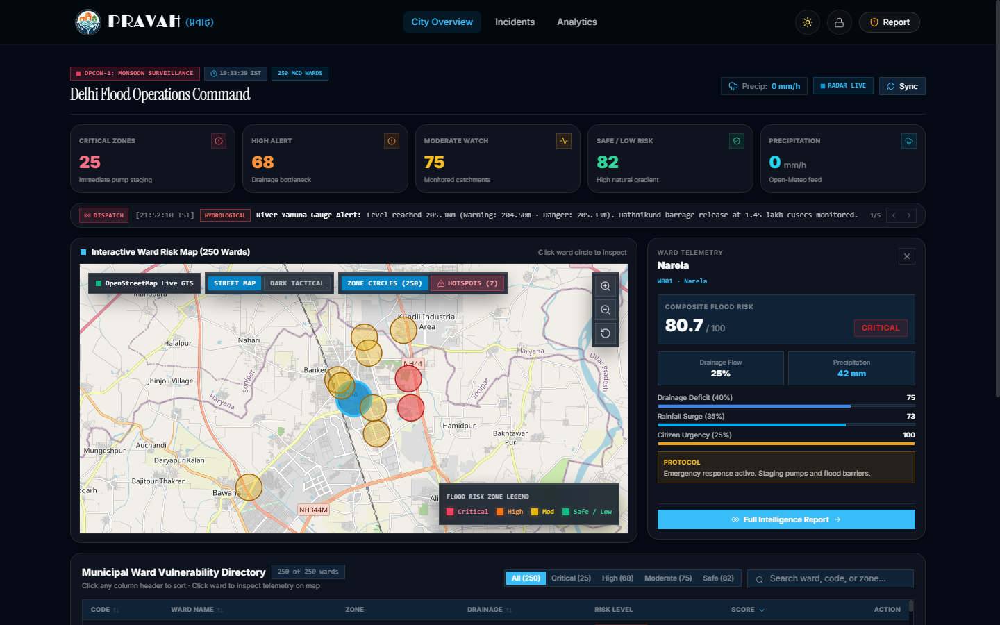
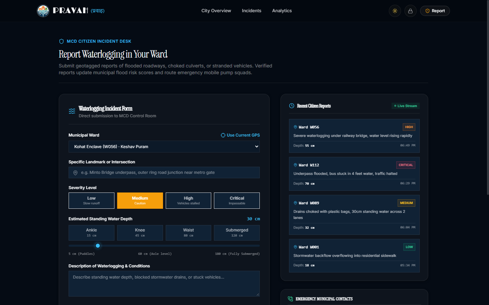
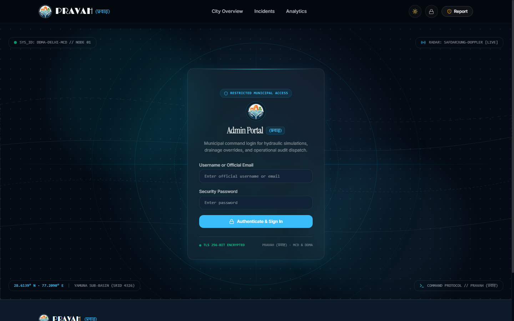
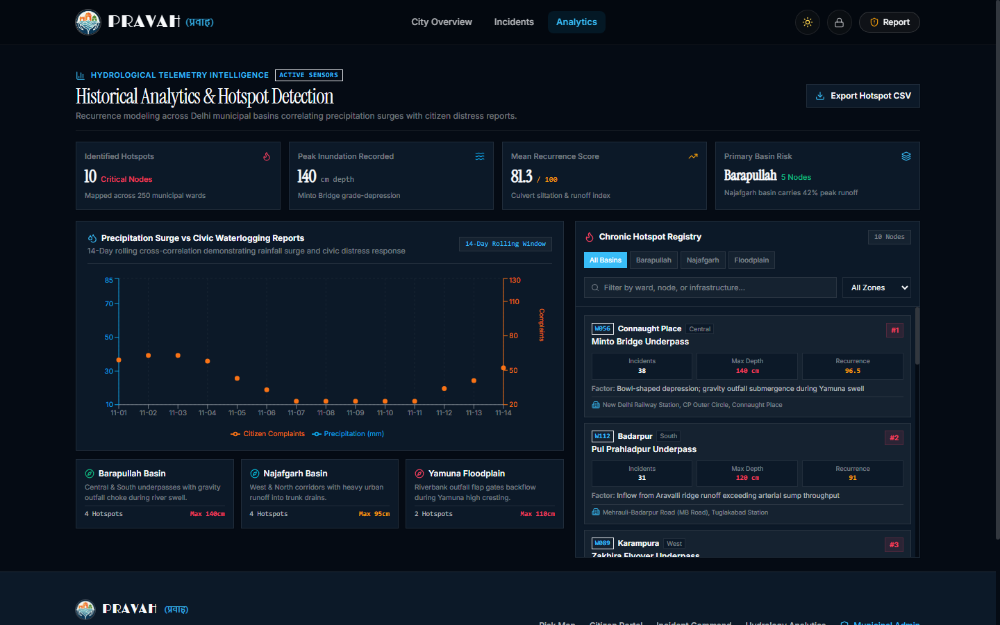
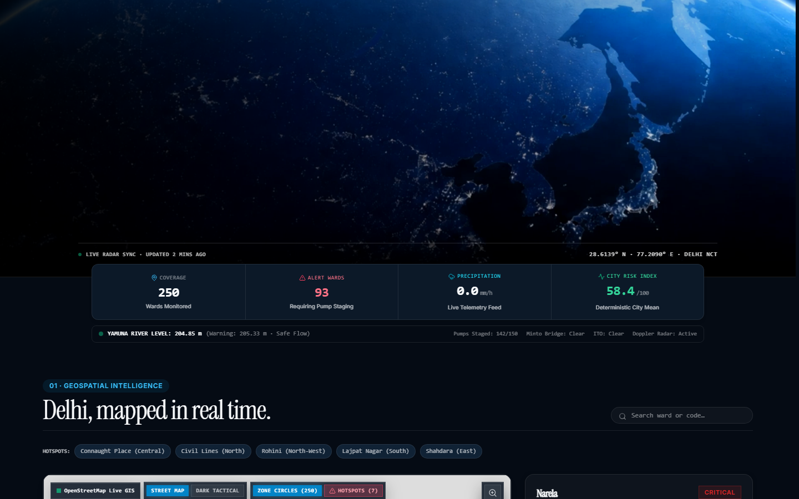
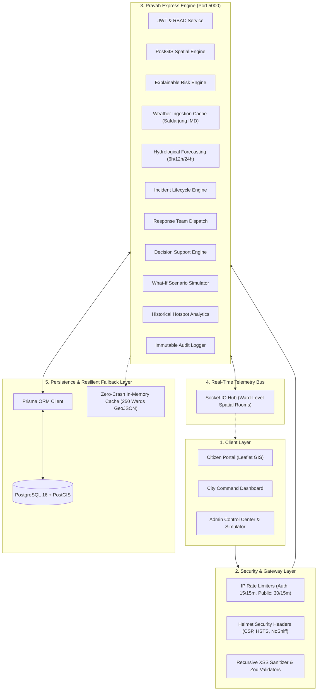

<div align="center">

  

  # PRAVAH (प्रवाह)
  ### Delhi Municipal Flood Intelligence, Explainable Risk Modeling & Emergency Dispatch Grid

  <p align="center">
    A production-grade geospatial flood monitoring, deterministic hydrological forecasting, incident command dispatch, and decision support platform engineered for the <strong>National Capital Territory of Delhi (250 Municipal Wards)</strong>.
  </p>

</div>
<br clear="left" />

---

## 🧭 Table of Contents

- [🌟 What is Pravah?](#-what-is-pravah)
- [📸 System Showcase](#-system-showcase)
- [⚡ Key Platform Capabilities](#-key-platform-capabilities)
- [📐 Deterministic Risk Mass-Balance Model](#-deterministic-risk-mass-balance-model)
- [🏗️ System Architecture](#-system-architecture)
- [📡 REST API Reference](#-rest-api-reference)
- [💻 Developer Quickstart](#-developer-quickstart)
- [🧪 Automated Reliability & Verification Suites](#-automated-reliability--verification-suites)
- [🔐 Security, RBAC & Offline Resilience](#-security-rbac--offline-resilience)
- [📚 Technical Documentation Index](#-technical-documentation-index)

---

## 🌟 What is Pravah?

During peak monsoon events, Delhi's urban runoff challenges culvert capacities, road underpasses, and low-lying settlements along the Yamuna floodplain. **Pravah (प्रवाह)** replaces opaque heuristics with a **transparent, physics-grounded hydrological model** and **sub-second PostGIS spatial indexing** across all 250 municipal wards of the Municipal Corporation of Delhi (MCD).

### Why Pravah?
- 🌊 **Predictive, Not Reactive**: Sub-second Doppler radar precipitation integration identifies convective rainfall accumulation before standing water rises.
- 📐 **100% Explainable**: No black-box AI drift. Every risk index (0–100) breaks down into exact mathematical weights for drainage culvert capacity, precipitation intensity, and citizen distress reports.
- 🚜 **Tactical Decision Support**: "What Should the City Do Now?" algorithm ranks interventions (high-capacity dewatering pump deployment, traffic diversion, alert dispatches) based on resource proximity.
- 🛡️ **Zero-Crash Resilient Architecture**: Uninterrupted operations with local in-memory spatial caches and mock fallback feeds if external weather APIs or databases experience network disruption.

---

## 📸 System Showcase

<div align="center">

### 1. Unified Earth Observatory & Live Grid Hero
*Cinematic dual-theme observatory with live Safdarjung Doppler radar sync and real-time municipal ward telemetry.*



</div>

<br />

| 🗺️ Interactive City Risk Map (`/dashboard`) | 🚨 Citizen Waterlogging Portal (`/report`) |
| :---: | :---: |
| [](docs/images/city-risk-map.png) | [](docs/images/citizen-portal.png) |
| *Color-coded 250-ward PostGIS spatial heat map with real-time risk scores and quick ward inspection drawer.* | *Public mobile-first reporting interface with auto GPS reverse-geocoding, camera upload, and duplicate clustering.* |

| 🛡️ Municipal Admin Command Console (`/admin`) | 📈 Multi-Horizon Hydrological Analytics (`/analytics`) |
| :---: | :---: |
| [](docs/images/admin-portal.png) | [](docs/images/hydrology-analytics.png) |
| *Command center for What-If simulations, culvert overrides, emergency dispatches, and immutable audit logs.* | *Yamuna river gauge levels, historical waterlogging hotspots, and 6h / 12h / 24h predictive flood projection curves.* |

<div align="center">

### 2. End-to-End Operational Pipeline & Minimal Institutional Footprint
*Four-step municipal pipeline connecting Doppler radar, PostGIS polygons, mass-balance risk, and pre-emptive pump dispatch with a clean minimal brand footer.*



</div>

---

## ⚡ Key Platform Capabilities

| Capability | Technical Mechanism | Operational Value |
| :--- | :--- | :--- |
| **Explainable Risk Engine** | Deterministic mass-balance equation: $(S_{\text{drain}} \times 0.40) + (S_{\text{rain}} \times 0.35) + (S_{\text{complaints}} \times 0.25)$ | Transparent 0–100 vulnerability score per ward with primary driver attribution and data freshness confidence tags. |
| **PostGIS Spatial Architecture** | PostGIS `GEOMETRY(Polygon, 4326)` & `POINT(4326)` with spatial R-tree indexing | Sub-millisecond point-in-polygon mapping of citizen reports and spatial equipment proximity queries. |
| **"What Should the City Do Now?"** | Multi-attribute decision scoring combining ward vulnerability, standing water, and equipment proximity | Automated, ranked tactical action roadmap for incident commanders (mobile pumps, road closures, citizen alerts). |
| **What-If Scenario Simulator** | Hydrological digital twin computing delta risk ($\Delta \text{Risk}$) and operational feasibility | Safe sandbox to stress-test high-capacity pump deployments and desilting before dispatching physical assets. |
| **Multi-Horizon Forecasting** | Physics-grounded hydrological projections across 6h, 12h, and 24h horizons | Early flood warnings with uncertainty intervals, soil saturation decay, and time-to-peak inundation. |
| **Real-Time Telemetry Bus** | Socket.IO WebSocket broadcast engine with ward-level spatial rooms | Instant streaming of new complaints, pump dispatches, culvert capacity updates, and radar precipitation. |
| **OWASP Security Hardening** | Helmet CSP/HSTS, Bcrypt hashing, signed JWTs, IP rate limiting, recursive XSS sanitization | Enterprise-grade protection against brute force, credential stuffing, injection, and privilege escalation. |
| **Zero-Crash Resilient Architecture** | In-memory spatial caches with automatic database failover and reconnection | Uninterrupted emergency operations even if PostgreSQL or external weather APIs experience outages. |

---

## 📐 Deterministic Risk Mass-Balance Model

Pravah rejects black-box neural networks for life-critical municipal infrastructure decisions. Instead, it utilizes an explainable **deterministic mass-balance model**:

$$\text{Risk Score} = (S_{\text{drainage}} \times 0.40) + (S_{\text{rainfall}} \times 0.35) + (S_{\text{complaints}} \times 0.25)$$

### Mathematical Factor Breakdown
1. **Drainage Deficit Factor ($S_{\text{drainage}}$ — 40% Weight)**:
   - Evaluates current desilting level against culvert cross-section capacity.
   - Silted drains ($< 50\%$ capacity) drastically heighten runoff accumulation risk.
2. **Precipitation Intensity ($S_{\text{rainfall}}$ — 35% Weight)**:
   - Real-time radar ingestion from Safdarjung IMD station combined with rolling 14-day soil moisture saturation.
   - Runoff coefficient scales non-linearly when antecedent rainfall exceeds 25 mm.
3. **Civic Distress Ground Truth ($S_{\text{complaints}}$ — 25% Weight)**:
   - Geotagged citizen reports validated through coordinate boundary checks.
   - Dynamically deduplicated and chronologically decayed over a 6-hour half-life curve.

---

## 🏗️ System Architecture



---

## 📡 REST API Reference

<details>
<summary><strong>1. Wards & GIS Spatial Services</strong> (Click to expand)</summary>

- `GET /api/wards` — Returns GeoJSON FeatureCollection of all 250 municipal wards with computed risk scores.
- `GET /api/wards/search?q=:query` — Searches wards by name, code, or administrative zone.
- `POST /api/wards/lookup-point` — Point-in-polygon containment lookup mapping GPS coordinates to containing ward.
- `GET /api/wards/:id` — Retrieves comprehensive ward detail, active incidents, and infrastructure assets.

</details>

<details>
<summary><strong>2. Risk Engine & Forecasting</strong> (Click to expand)</summary>

- `GET /api/risk/summary` & `GET /api/risk-summary` — Aggregate citywide risk metrics, critical counts, and top vulnerable wards.
- `GET /api/risk/ward/:id` — Explainable risk breakdown with mathematical factor contributions.
- `GET /api/forecasting/ward/:id` — Multi-horizon flood forecast projections (6h, 12h, 24h) with confidence intervals.
- `GET /api/forecasting/city` & `GET /api/prediction` — 24-hour citywide risk escalation overview identifying wards likely to flood.

</details>

<details>
<summary><strong>3. Decision Support & What-If Simulation</strong> (Click to expand)</summary>

- `GET /api/decision-support/ward/:id` — Generates ranked tactical action plans for a ward.
- `GET /api/decision-support/city` — Citywide prioritized intervention roadmap for incident command.
- `POST /api/simulation/ward` — Simulates pump deployment or rainfall surge and calculates delta risk ($\Delta \text{Risk}$).
- `GET /api/simulation/presets` — Pre-calibrated emergency simulation scenarios (e.g. Yamuna overflow, cloudburst).

</details>

<details>
<summary><strong>4. Complaints, Incidents & Response Teams</strong> (Click to expand)</summary>

- `POST /api/complaints` & `POST /api/complaint` — Submits citizen waterlogging report with automatic PostGIS ward mapping.
- `GET /api/incidents` — Lists active operational flood incidents.
- `POST /api/response-teams/dispatch` — Assigns emergency response team and equipment to an active incident.

</details>

<details>
<summary><strong>5. Administration & Security Audit</strong> (Click to expand)</summary>

- `POST /api/auth/login` — Authenticates credentials and issues signed JWT bearer token.
- `GET /api/admin/overview` — Administrative ward vulnerability overview.
- `POST /api/admin/update-drainage` — Updates ward drainage capacity and writes to immutable audit log.
- `GET /api/admin/audit-logs` — Retrieves security event history.

</details>

---

## 💻 Developer Quickstart

### Prerequisites
- **Node.js**: v18.0.0 or higher
- **npm**: v9.0.0 or higher
- **PostgreSQL & PostGIS** *(Optional: system includes offline zero-crash fallback if DB is not installed)*

### Universal One-Command Launch (Root)
```powershell
# Clones repository and installs all dependencies
git clone https://github.com/suhaniyadav-netizen/Pravah.git
cd Pravah

# Installs root and client packages
npm install
cd client && npm install && cd ..
cd server && npm install && cd ..

# Concurrently runs Server (port 5000) and Vite React Client (port 5173)
npm run dev
```

### Manual Individual Component Setup

<details>
<summary><strong>Backend Server (`server/`)</strong></summary>

```powershell
cd server
npm install

# Setup database schema (when PostgreSQL is active)
npx prisma generate
npx prisma db push
npm run prisma:seed

# Start backend development server
npm run dev
```

</details>

<details>
<summary><strong>Modern React Client (`client/`)</strong></summary>

```powershell
cd client
npm install

# Start Vite dev server on http://localhost:5173
npm run dev

# Or build production static bundle
npm run build
```

</details>

<details>
<summary><strong>Demo Credentials</strong></summary>

| Role | Username / Email | Password | Access Scope |
| :--- | :--- | :--- | :--- |
| **Municipal Administrator** | `admin@pravah.delhi.gov.in` | `PravahDev@2026` | Full Control: Drainage Overrides, Dispatches, Audits |
| **Legacy Admin Quickpass** | `admin` | `admin123` | Quick evaluation fallback |
| **Hydrological Analyst** | `analyst@pravah.delhi.gov.in` | `PravahDev@2026` | Read-only analytics, telemetry & what-if simulator |
| **Response Team Lead** | `team.central@pravah.delhi.gov.in` | `PravahDev@2026` | Incident acknowledgment & pump dispatch acceptance |
| **Citizen Reporter** | `citizen.delhi@example.com` | `PravahDev@2026` | Public report submission & ward verification |

</details>

---

## 🧪 Automated Reliability & Verification Suites

Pravah enforces strict reliability guarantees. All failure scenarios, boundary checks, and client regressions are verified via automated test suites:

```powershell
# Run Master Failure & Reliability Suite (19/19 checks)
npm test

# Run Client Integration & Legacy Endpoint Suite (9/9 checks)
npm run verify:phase15
```

<details>
<summary><strong>Master Test Suite Breakdown (19/19 Verification Checks)</strong></summary>

1. **System Health & Discovery**: Health check returns HTTP 200 with service dependencies.
2. **Database Disconnection Fallback**: Resilient fallback returns 250 wards, risk summaries, and simulations offline.
3. **Weather Stale Telemetry Handling**: Stale weather data (>12h) is tagged and throttled gracefully.
4. **GIS Coordinate Validation**: Boundary enforcement rejects coordinates outside Delhi municipal territory (400 Bad Request).
5. **Schema Validation & Sanitization**: Zod validation blocks malformed severity enums and short payloads.
6. **Authentication & RBAC Defenses**: Prevents privilege escalation and forged JWT payloads.
7. **End-to-End Operational Lifecycle Drill**: Verifies full complaint submission → incident generation → decision support ranking → what-if simulation risk delta ($\Delta \text{Risk}$).

</details>

---

## 🔐 Security, RBAC & Offline Resilience

- **OWASP Hardened**: Helmet HTTP security headers (Strict-Transport-Security, Content-Security-Policy, X-Content-Type-Options: nosniff).
- **Authentication**: Signed stateless JSON Web Tokens (JWT) with HMAC-SHA256 and 8-hour expiration.
- **Audit Logging**: All administrative drainage modifications and pump overrides generate permanent, immutable audit records.
- **Offline Resilience**: If PostgreSQL or IMD Safdarjung weather APIs become unreachable, Pravah switches instantly to zero-crash memory cache (`server/data/demo-ward-boundaries.json`), preventing system downtime during emergency events.

---

## 📚 Technical Documentation Index

For in-depth architectural specifications and implementation guides, explore the `docs/` repository:

| Document | Topic Covered |
| :--- | :--- |
| [System Architecture](docs/system-architecture.md) | High-level system topology, process model & scaling |
| [Explainable Risk Engine](docs/risk-engine-v2.md) | Mathematical mass-balance formulation & factor weights |
| [GIS & Ward Spatial API](docs/ward-gis-api.md) | PostGIS spatial queries, R-tree indexing & GeoJSON schema |
| [Decision Support Engine](docs/decision-support-engine.md) | Tactical intervention ranking and resource matching |
| [What-If Scenario Simulator](docs/what-if-simulator.md) | Hydrological simulation formulas & delta risk calculation |
| [Hydrological Forecasting](docs/forecasting-architecture.md) | 6h, 12h, and 24h multi-horizon projection models |
| [Real-Time Socket Architecture](docs/realtime-socket-architecture.md) | WebSocket protocol, spatial room partitioning & event contracts |
| [Security Hardening & RBAC](docs/security-hardening.md) | OWASP defense checklist, JWT schema & rate-limit configurations |
| [Testing & Reliability Runbook](docs/testing-and-reliability.md) | Master failure drills, fault tolerance & test runbook |

---

<div align="center">

  **PRAVAH (प्रवाह)** · Designed & Engineered by [**Suhani Yadav**](https://github.com/suhaniyadav-netizen/Pravah)  
  *In collaboration with the Municipal Corporation of Delhi (MCD) & Delhi Disaster Management Authority (DDMA)*

</div>
